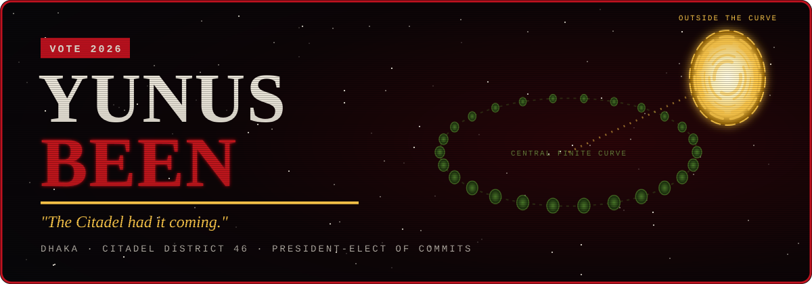

<div align="center">



<a href="https://git.io/typing-svg"></a>

<br/>


</div>


## `> whoami`

```console
neo@nebuchadnezzar:~$ cat /dev/operator/yunus_been.log

  ╔══════════════════════════════════════════════════════════════╗
  ║  SUBJECT ........ Yunus Been                                 ║
  ║  BASE ........... Dhaka, Bangladesh                          ║
  ║  CLASS .......... Competitive programmer · hackathon runner  ║
  ║  PRIMARY OS ..... Linux (Ubuntu) — the real world            ║
  ║  CORE LANGS ..... Java · C++ · Python · TypeScript           ║
  ║  CURRENT TASK ... building AI tools that supervise AI agents ║
  ║  TRAINING ....... ICPC prep · DSA · systems design           ║
  ║  THREAT LEVEL ... ██████████░░  rising                       ║
  ╚══════════════════════════════════════════════════════════════╝

neo@nebuchadnezzar:~$ █
```

> *"I know Kung Fu."* — me, after one more Codeforces round.


## `> choose_your_pill`

<table>
<tr>
<td width="50%" valign="top">

### 🔴 The red pill — what I'm chasing

- 🧠 **AI tooling** that keeps coding agents honest (see **TeamMate** below)
- 🏆 **ICPC** — grinding algorithms in C++ until the code looks like green rain
- 🐚 Writing low-level stuff from scratch: shells, simulators, CLIs
- 🏙️ Shipping hackathon builds for real Dhaka problems
- 📐 Systems design — how the machine city is actually wired

</td>
<td width="50%" valign="top">

### 🔵 The blue pill — what I refuse

- ❌ Copy-pasting code I don't understand
- ❌ "It works on my machine"
- ❌ Shipping without tests
- ❌ Living in someone else's simulation
- ❌ Tabs vs spaces debates (I'm busy)

</td>
</tr>
</table>


## `> load_program --arsenal`

<div align="center">

**Weapons — lots of weapons.**

<br/>
<br/>


</div>


## `> ls ~/implanted_memories/`

*Memories, you're talking about memories.* — Projects I've jacked into:

| ⌬ | Project | What it does | Stack |
|:-:|---|---|:-:|
| 🟢 | **[TeamMate](https://github.com/yunuszoro46-sketch/HackOberfest-Hack-Day-Dhaka)** | Supervises AI coding agents: an AI council stress-tests your idea, you sign off, it compiles the build prompt + acceptance tests, then checks the agent's work. [**Live demo →**](https://hackoberfest-hack-day-dhaka-1.onrender.com/) |  |
| 🟢 | **[shell-with-java](https://github.com/yunuszoro46-sketch/shell-with-java-)** | A POSIX-style shell built from scratch — REPL, built-ins, PATH resolution, quoting. |  |
| 🟢 | **[ICPC-PRACTICE](https://github.com/yunuszoro46-sketch/ICPC-PRACTICE)** | Competitive programming solutions and algorithm templates for ICPC / JRC prep. |  |
| 🟠 | **[DhakaPath](https://github.com/yunuszoro46-sketch/DhakaPath)** | Finding a way through the most chaotic grid in the sprawl. |  |
| 🟠 | **[UltronAI](https://github.com/yunuszoro46-sketch/UltronAI)** | An AI experiment. There are no strings on me. |  |
| 🟠 | **[MINI-HACKATHON](https://github.com/yunuszoro46-sketch/MINI-HACKATHON--CONTEST)** | AI-driven e-commerce search with natural-language queries and dynamic filters. |  |
| 🔵 | **[java-VirtualDiece-game](https://github.com/yunuszoro46-sketch/java-VirtualDiece-game)** | CLI betting simulator — Roll Over / Roll Under with virtual currency. |  |
| 🔵 | **[Systems-Design-Fundamentals](https://github.com/yunuszoro46-sketch/Systems-Design-Fundamentals)** | Notes and code on how large systems are built. |  |


## `> cat /var/log/hackathons.log`

```diff
+ [2026-10] HackOberfest Hack Day Dhaka ......... TeamMate — AI agent supervisor
+ [2026-10] 9th DRMC International Tech Carnival  in the arena
+ [2026-10] HackApex Intra Hackathon ............ shipped
+ [2026-09] BUP Hackathon 2026 .................. shipped (Python)
+ [2026-05] Mini Hackathon Contest .............. AI product search engine
! [NEXT]    your hackathon? → ping me, I need an operator.
```


## `> voight-kampff --subject yunus_been`

<details>
<summary><b>⚠️ Run the empathy test (click to expand)</b></summary>
<br/>

| # | Question | Response | Pupil dilation |
|:-:|---|---|:-:|
| 1 | You find a tortoise on its back in the desert. Its test suite is failing. | *I flip it over and fix the flaky test.* | `normal` |
| 2 | A merge conflict appears at 3 a.m. before the deadline. | *I resolve it. By hand. Without rebasing someone else's branch.* | `normal` |
| 3 | Describe in single words only the good things about your mother. | *`O(log n)`.* | `▲ spike` |
| 4 | Someone says Java is dead. | *…* | `⚠ off the charts` |

**Verdict:** `INCONCLUSIVE — possibly human. Definitely ships.` 🦄

</details>


## `> scan --telemetry`

<div align="center">


</div>


## `> open_channel`

<div align="center">

```
  ┌──────────────────────────────────────────────┐
  │  INCOMING CALL ... the phone is ringing.     │
  │  Pick it up before the agents find you.      │
  └──────────────────────────────────────────────┘
```

<a href="https://github.com/yunuszoro46-sketch"></a>
<!-- Add more channels here, e.g. LinkedIn / email:
<a href="mailto:YOU@example.com"></a>
-->

<br/><br/>


<sub>`// end of transmission — wake up.`</sub>

</div>
