<!-- Profile README for github.com/yunuszoro46-sketch. Banner and footer are static SVGs in ./assets. -->

  

<h1 align="center">Yunus Been Hashem</h1>

  <b>Aspiring Software Engineer · AI &amp; Full-Stack Development</b> 
  CSE undergraduate at University of Asia Pacific, Dhaka. I build practical, tested software for real local problems.

  
  
  
  

  <a href="https://www.linkedin.com/in/yunus-been-hashem-7632b3444/">LinkedIn</a> ·
  <a href="https://github.com/yunuszoro46-sketch">GitHub</a> ·
  <a href="#featured-projects">Projects</a> ·
  <a href="#achievements">Achievements</a> ·
  <a href="#contact">Contact</a>

---

## About Me

I'm a Computer Science and Engineering undergraduate at the **University of Asia Pacific (UAP)** in Dhaka. I like software that solves a specific problem for specific people: event registration for a student club, generator schedules during load-shedding, routes and fares for Dhaka commuters.

Most of what I've built started at a hackathon. The format suits me: a fixed deadline, a real brief, and a working demo at the end. Lately I've focused on **AI-powered applications**, with one rule I try to keep: the core logic should be deterministic and tested, and the model should add value on top of it rather than hold the system up. I use AI coding tools in my workflow and check their output with automated tests.

Alongside projects, I'm strengthening my computer science fundamentals — data structures and algorithms in C++, and core concepts in Java — because I want to write software that stays maintainable after the demo.

## Achievements

| Result | Competition | Details |
|---|---|---|
| **Champion** (1st place) | 9th DRMC International Tech Carnival 2026 — AI Web Development segment | Organized by DRMC IT Club · Project: [Smart Club Operations](https://github.com/yunuszoro46-sketch/9th-DRMC-International-Tech-Carnival-2026-) |
| **Champion** | UAP HackApex Intra Hackathon | Project: [StayOn](https://github.com/yunuszoro46-sketch/HackApex-Intra-Hackathon) (team) |
| **Rising Star** | Mini Hackathon Contest, Dev Fusion — May 2026 | Software &amp; Hardware Club, CSE-UAP · Team "The Beta Testers" |

Also built for: 3rd IAIT National IT Fest Hackathon (INIF 2026) — [DhakaPath](https://github.com/yunuszoro46-sketch/DhakaPath) · HackOberfest Hack Day Dhaka — [TeamMate](https://github.com/yunuszoro46-sketch/HackOberfest-Hack-Day-Dhaka)

## Featured Projects

### Smart Club Operations Platform
<code>0x01</code> · Champion project, AI Web Development — 9th DRMC International Tech Carnival 2026

Student clubs run events on Google Forms, spreadsheets and chat groups. This platform replaces that with one system: **Club → Fest → Event → Registration → Digital Pass**.

- Event discovery with search and club/category filters; registration without an account
- Organizer console with a **registration form builder**, approval flow, archiving and a live dashboard
- Server-enforced rules: deadlines, seat limits, duplicate prevention; **QR digital passes** that can be revoked
- Organizer sign-in exchanges a shared key for a short-lived JWT
- "Tech Guide" assistant answers from live event data; an OpenAI-compatible model is optional and off by default

**Stack:** React 19 · Vite · Node.js (native HTTP, layered services/repositories) · SQLite (`node:sqlite`) 
[Repository](https://github.com/yunuszoro46-sketch/9th-DRMC-International-Tech-Carnival-2026-) · [Live demo](https://nineth-drmc-international-tech-carnival.onrender.com/)

### StayOn — generator rosters for load-shedding days
<code>0x02</code> · Team project · UAP HackApex Intra Hackathon

A shopping complex has one generator, a fixed diesel budget and more demand than capacity. StayOn decides, for every outage hour, which shops stay on.

- Computes a roster that is **proven optimal** within the rules: never overloads the generator, never exceeds the diesel budget, always powers mandatory loads (e.g. a pharmacy fridge)
- Gives a reason with real numbers for every shop left dark
- When no roster can satisfy every rule, reports which rule fails and by how much
- 39 automated tests, including a comparison against a brute-force solver on 300 random markets; zero dependencies

**Stack:** JavaScript · Node.js · Node test runner 
[Repository](https://github.com/yunuszoro46-sketch/HackApex-Intra-Hackathon) · [Live demo](https://hackapex-intra-hackathon-6d7w.onrender.com/)

### DhakaPath — route, fare and street-alert assistant
<code>0x03</code> · Team project · INIF 2026 Smart City hackathon

Getting across Dhaka means combining buses, metro, rickshaws and CNGs with unclear fares. DhakaPath plans multi-mode trips over a transit graph.

- The network graph decides routes, fares and alerts; AI only interprets messages and phrases explanations — **everything works without an AI key**
- Bus and MRT-6 fares follow published official rates; rickshaw and CNG fares are clearly labelled as estimates
- Monsoon mode for heavy-rain disruptions, full Bangla interface, admin CMS for alerts
- 96 automated tests; one Node.js process, no database, no required dependencies

**Stack:** Node.js · vanilla JavaScript (ES modules) · Leaflet · optional Gemini / Groq 
[Repository](https://github.com/yunuszoro46-sketch/DhakaPath) · [Live demo](https://threerd-iait-national-it-fest-hackathon.onrender.com/)

### TeamMate — a supervisor for AI coding agents
<code>0x04</code> · HackOberfest Hack Day Dhaka

For solo builders who have an idea but no team. TeamMate turns an idea into a plan a coding agent can build — and then checks the result.

- Five fixed questions, a "council" of three AI critics and live competitor search
- Architecture options, a human sign-off step, then a compiled build prompt with acceptance tests
- Verifies a coding agent's report against each acceptance criterion and writes the fix-up prompt
- Every generated field is editable and lockable, with a provenance badge; runs in a mock mode without an API key

**Stack:** Next.js · TypeScript · Tailwind CSS · Gemini API · Tavily search · Vitest · Playwright 
[Repository](https://github.com/yunuszoro46-sketch/HackOberfest-Hack-Day-Dhaka) · [Live demo](https://hackoberfest-hack-day-dhaka-1.onrender.com/)

Demos run on free hosting tiers; the first load after a quiet period can take up to a minute.

## Tech Stack

Technologies I have used in the projects above or in my coursework and practice repositories.

| Area | Technologies |
|---|---|
| **Languages** |  Java · C++ · Python · TypeScript · JavaScript |
| **Frontend** |  React · Next.js · Vite · Tailwind CSS · HTML · CSS |
| **Backend &amp; data** |  Node.js (native HTTP, REST APIs) · SQLite |
| **AI** | Gemini API · OpenAI-compatible APIs · Groq · Tavily search · AI coding assistants |
| **Testing** | Vitest · Playwright · Node test runner |
| **Tools** |  Git · GitHub · Linux (Ubuntu) · VS Code · Render · Vercel |

## Currently Learning

- **Data structures and algorithms** — competitive programming practice in C++ ([ICPC-PRACTICE](https://github.com/yunuszoro46-sketch/ICPC-PRACTICE))
- **Java and computer science fundamentals** — OOP, core Java, systems design basics
- **Full-stack application development** — cleaner architecture, testing and deployment
- **AI-powered software and developer tooling** — reliable LLM integration and agent workflows

## GitHub Activity

  

The full contribution graph is shown below this README on the profile page.

## Contact

I'm open to internships, collaborations and hackathon teams.

- **LinkedIn:** [linkedin.com/in/yunus-been-hashem-7632b3444](https://www.linkedin.com/in/yunus-been-hashem-7632b3444/)
- **GitHub:** [github.com/yunuszoro46-sketch](https://github.com/yunuszoro46-sketch)

---

  

