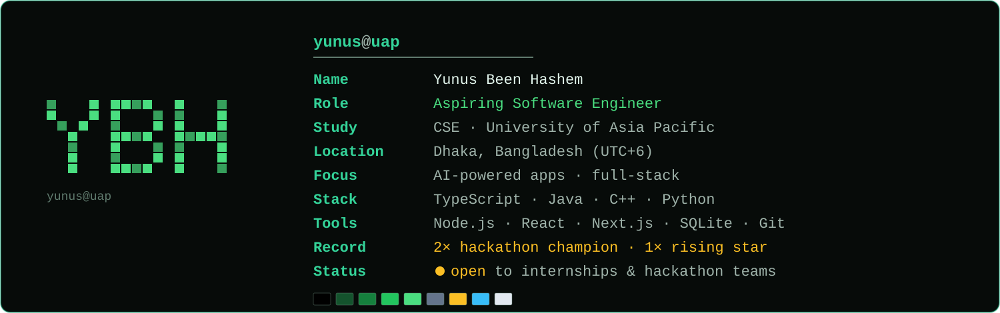
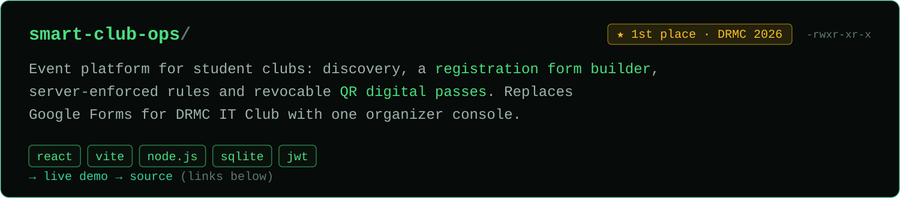
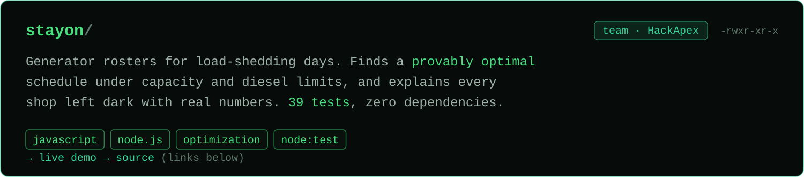
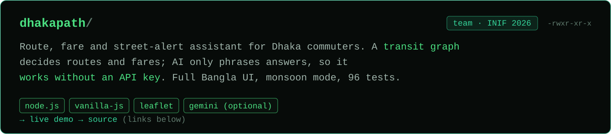
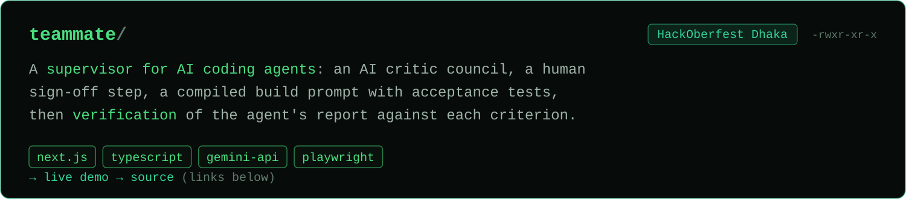
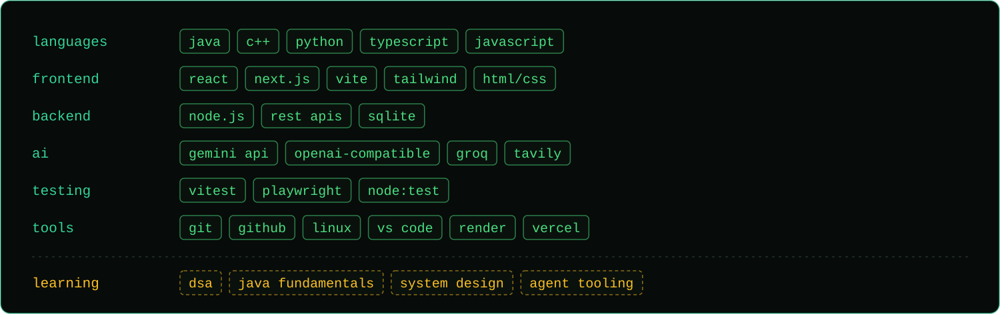

<!-- Profile README for github.com/yunuszoro46-sketch. All custom visuals are SVGs in ./assets (see assets/*.svg). -->

  

<h1 align="center">Yunus Been Hashem</h1>

  <b>Aspiring Software Engineer · AI &amp; Full-Stack Development</b> 
  CSE undergraduate at University of Asia Pacific, Dhaka. I build practical, tested software for real local problems.

  <code>[✓] based in Dhaka (UTC+6)</code>&nbsp;
  <code>[✓] 2× hackathon champion</code>&nbsp;
  <code>[✓] open to internships</code>

  &nbsp;&nbsp;
  

  <a href="https://www.linkedin.com/in/yunus-been-hashem-7632b3444/">LinkedIn</a> ·
  <a href="https://github.com/yunuszoro46-sketch">GitHub</a> ·
  <a href="#featured-projects">Projects</a> ·
  <a href="#achievements">Achievements</a> ·
  <a href="#contact">Contact</a>

 

## About Me

I'm a Computer Science and Engineering undergraduate at the **University of Asia Pacific (UAP)** in Dhaka. I like software that solves a specific problem for specific people: event registration for a student club, generator schedules during load-shedding, routes and fares for Dhaka commuters.

Most of what I've built started at a hackathon. The format suits me: a fixed deadline, a real brief, and a working demo at the end. Lately I've focused on **AI-powered applications**, with one rule I try to keep: the core logic should be deterministic and tested, and the model should add value on top of it rather than hold the system up. I use AI coding tools in my workflow and check their output with automated tests.

Alongside projects, I'm strengthening my computer science fundamentals — data structures and algorithms in C++, and core concepts in Java — because I want to write software that stays maintainable after the demo.

## Achievements

| Result | Competition | Details |
|---|---|---|
| **Champion** (1st place) | 9th DRMC International Tech Carnival 2026 — AI Web Development segment | Organized by DRMC IT Club · Project: [Smart Club Operations](https://github.com/yunuszoro46-sketch/9th-DRMC-International-Tech-Carnival-2026-) |
| **Champion** | UAP HackApex Intra Hackathon | Project: [StayOn](https://github.com/yunuszoro46-sketch/HackApex-Intra-Hackathon) (team) |
| **Rising Star** | Mini Hackathon Contest, Dev Fusion — May 2026 | Software &amp; Hardware Club, CSE-UAP · Team "The Beta Testers" |

Also built for: 3rd IAIT National IT Fest Hackathon (INIF 2026) — [DhakaPath](https://github.com/yunuszoro46-sketch/DhakaPath) · HackOberfest Hack Day Dhaka — [TeamMate](https://github.com/yunuszoro46-sketch/HackOberfest-Hack-Day-Dhaka)

## Featured Projects

**Smart Club Operations Platform** — [source](https://github.com/yunuszoro46-sketch/9th-DRMC-International-Tech-Carnival-2026-) · [live demo](https://nineth-drmc-international-tech-carnival.onrender.com/)

Key features

- Event discovery with search and club/category filters; registration without an account
- Organizer console with a registration form builder, approval flow, archiving and a live dashboard
- Server-enforced rules: deadlines, seat limits, duplicate prevention; QR digital passes that can be revoked
- Organizer sign-in exchanges a shared key for a short-lived JWT
- "Tech Guide" assistant answers from live event data; an OpenAI-compatible model is optional and off by default
- **Stack:** React 19 · Vite · Node.js (native HTTP, layered services/repositories) · SQLite (`node:sqlite`)

**StayOn** — [source](https://github.com/yunuszoro46-sketch/HackApex-Intra-Hackathon) · [live demo](https://hackapex-intra-hackathon-6d7w.onrender.com/)

Key features

- Computes a roster that is proven optimal within the rules: never overloads the generator, never exceeds the diesel budget, always powers mandatory loads (e.g. a pharmacy fridge)
- Gives a reason with real numbers for every shop left dark
- When no roster can satisfy every rule, reports which rule fails and by how much
- 39 automated tests, including a comparison against a brute-force solver on 300 random markets; zero dependencies
- **Stack:** JavaScript · Node.js · Node test runner

**DhakaPath** — [source](https://github.com/yunuszoro46-sketch/DhakaPath) · [live demo](https://threerd-iait-national-it-fest-hackathon.onrender.com/)

Key features

- The network graph decides routes, fares and alerts; AI only interprets messages and phrases explanations — everything works without an AI key
- Bus and MRT-6 fares follow published official rates; rickshaw and CNG fares are clearly labelled as estimates
- Monsoon mode for heavy-rain disruptions, full Bangla interface, admin CMS for alerts
- 96 automated tests; one Node.js process, no database, no required dependencies
- **Stack:** Node.js · vanilla JavaScript (ES modules) · Leaflet · optional Gemini / Groq

**TeamMate** — [source](https://github.com/yunuszoro46-sketch/HackOberfest-Hack-Day-Dhaka) · [live demo](https://hackoberfest-hack-day-dhaka-1.onrender.com/)

Key features

- Five fixed questions, a "council" of three AI critics and live competitor search
- Architecture options, a human sign-off step, then a compiled build prompt with acceptance tests
- Verifies a coding agent's report against each acceptance criterion and writes the fix-up prompt
- Every generated field is editable and lockable, with a provenance badge; runs in a mock mode without an API key
- **Stack:** Next.js · TypeScript · Tailwind CSS · Gemini API · Tavily search · Vitest · Playwright

Demos run on free hosting tiers; the first load after a quiet period can take up to a minute.

## Tech Stack

## Currently Learning

- **Data structures and algorithms** — competitive programming practice in C++ ([ICPC-PRACTICE](https://github.com/yunuszoro46-sketch/ICPC-PRACTICE))
- **Java and computer science fundamentals** — OOP, core Java, systems design basics
- **Full-stack application development** — cleaner architecture, testing and deployment
- **AI-powered software and developer tooling** — reliable LLM integration and agent workflows

## GitHub Activity

  

The full contribution graph is shown below this README on the profile page.

## Contact

  <a href="https://www.linkedin.com/in/yunus-been-hashem-7632b3444/"><code>→ linkedin/yunus-been-hashem</code></a>&nbsp;
  <a href="https://github.com/yunuszoro46-sketch"><code>→ github/yunuszoro46-sketch</code></a>&nbsp;
  <a href="#featured-projects"><code>→ ~/projects</code></a>

 

  

